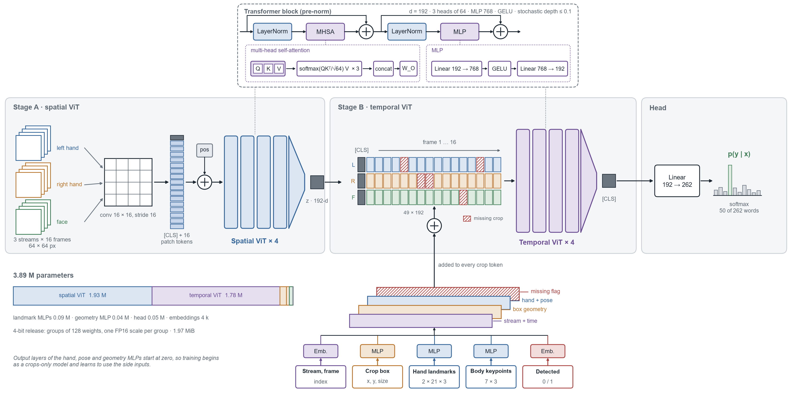
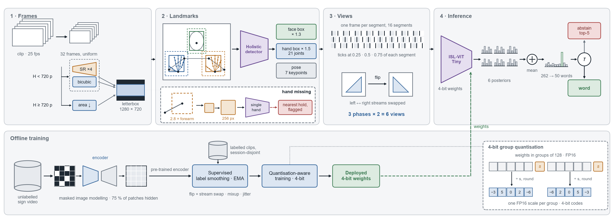

# Architecture diagrams: the network and the end-to-end pipeline

Two figures describe the system. Figure A shows the classifier, ISL-ViT-Tiny, as a graph of tensors and layers. Figure B shows everything around it: how a raw video becomes the network's inputs, how a prediction is produced, and how the weights were trained. Each box carries one operation, one tensor, or one decision, named with a standard term. Tensor shapes are those of the shipped configuration.

Sources: `report/architecture/make_architecture_diagrams.py` draws both figures with matplotlib. Shapes carry meaning: a funnel is an encoder that reduces a token sequence to one embedding, a grid is a token sequence, and offset squares are a stack of frames or crops. The figures are written as PNG, PDF and SVG to `docs/architecture/`; the PDF and SVG stay vector for a paper.

---

## Figure A. Network architecture

*Figure A. ISL-ViT-Tiny. A spatial Vision Transformer encodes each hand or face crop independently; a temporal Vision Transformer then attends across all crop tokens of the clip. The column of small squares in Stage A is the 17-token sequence (dark: [CLS]); the three rows in Stage B are the left-hand, right-hand and face tokens of the 16 frames, and hatched cells are crops with no detection. Each stack of four tall bars is four transformer blocks, followed by a funnel that reads out the [CLS] token. The dashed inset opens one block and, below it, the attention and MLP inside it. The offset sheets under Stage B are the conditioning terms: tensors of the same 3 × 16 × 192 shape that are added to the token grid. The bar at lower left splits the 3.89 M parameters by module.*

### Reading the figure

Start with the crops at the far left, then the five small boxes along the bottom. Together they are the inputs for a clip of 16 frames, and all of them are needed.

**Pixels.** Three 64 × 64 RGB crops per frame (left hand, right hand, face) give 48 crops per clip. They enter **Stage A**, a four-block Vision Transformer whose weights are shared across all 48 crops. A 16 × 16 convolution with stride 16 cuts each crop into a 4 × 4 grid of 16 patch tokens of width 192. A learned [CLS] token and a learned position embedding make 17 tokens. Four pre-LayerNorm transformer blocks follow, each with 3-head self-attention and a 192 → 768 → 192 MLP with GELU, with stochastic depth rising to 0.1. After a final LayerNorm the [CLS] token is read out as the crop's embedding, a vector in ℝ¹⁹². Stage A never sees more than one crop at a time, so its attention spans 17 tokens, not the 816 that joint attention over every patch of the clip would need.

**Three descriptions of where and how the hand is.** Cropping throws away location, and the pixels of a 64-pixel crop carry handshape only coarsely, so three side channels are added back.

* *Crop-box geometry* (centre x, centre y, size, normalised by the frame) passes through a two-layer MLP, 3 → 192 → 192.
* *Hand landmarks* (21 joints per hand, each with x, y, z) are turned into a handshape descriptor by subtracting the wrist, dividing by the hand's own extent, and correcting the 16:9 frame aspect so a rotated hand keeps its shape. That gives 63 numbers. The wrist position in the shoulder-midpoint frame, measured in shoulder widths, adds 2 more. The resulting 65-dimensional vector passes through a 65 → 192 → 192 MLP, gated by whether that hand was present, and is added to that hand's crop token.
* *Upper-body keypoints* (nose, shoulders, elbows, wrists, with visibility) are expressed in the same shoulder frame, giving 21 numbers. A 21 → 192 → 192 MLP projects them, and the result is added to the face token. The shoulders serve as the body frame for both landmark branches.

The final layer of each of these three MLPs starts at zero. At the first training step the network is therefore exactly a crops-only model, and it learns to use geometry and landmarks gradually without disturbing pretrained weights.

**A confidence flag.** The detection indicator is 1 where the hand or face detector fired and 0 where the box was interpolated from a neighbouring frame or absent. A learned 1 × 192 vector is added to every crop token whose indicator is 0, so the network can discount stale boxes. A no-hand frame also carries information of its own, since many signs are one-handed.

**Joining the branches.** The circled plus under the token grid is an element-wise sum, applied to each of the 48 crop tokens: the Stage A embedding, a learned stream embedding (which of the three streams), a learned time embedding (which of the 16 frames), and whichever of the geometry, missing-crop, hand and pose terms apply to that token. The output is 48 tokens of width 192.

**Stage B** prepends a [CLS] token to give a sequence of 49, runs it through a second stack of four transformer blocks with the same dimensions as Stage A, applies LayerNorm, and reads out the [CLS] vector as the clip embedding. A linear layer maps it to 262 word logits. Softmax gives a posterior over the 262 trained words. At inference the posterior is restricted to the 50 deployed words and renormalised.

### Capacity

The model has 3,894,214 parameters. The spatial encoder holds 1,930,944 and the temporal transformer blocks 1,779,456. The landmark MLPs hold 91,008, the geometry MLP 37,824 and the classifier head 50,566. The remaining 4,416 are embeddings, [CLS] tokens and LayerNorm parameters. The landmark branch is cheap: its MLPs are 2.3 % of the parameters, yet adding it raised top-1 from 73.7 % to 86.5 % in the project's controlled comparison. In the 4-bit release, weights are stored in groups of 128 with one FP16 scale per group.

### What the figure does not show

Training-time augmentation (flip with stream swap, colour jitter, stream dropout, resolution jitter, mixup), exponential moving average of weights, and the masked-image-modelling pretraining that initialises both stages appear in Figure B and the main text, not here. The 16 × 16 patch size and the width of 192 follow DeiT-Tiny so that its pretrained weights have the shape of Stage A.

---

## Figure B. End-to-end pipeline

*Figure B. From a video file to a word, and from unlabelled video to the deployed weights. Funnels are learned models, offset squares are stacks of frames, small bar charts are probability vectors, and the circle marked τ is the confidence threshold. Panel 2 is drawn on a frame, with the 21 hand joints, the seven body keypoints and the margin boxes; the dashed box beneath it is the rescue path for a missing hand. Panel 3 shows the three sampling phases as ticks inside 16 segments. The dashed green arrow carries the trained weights into inference, and the inset at lower right shows how they are stored: groups of weights sharing one scale and rounded to 4-bit codes.*

### Reading the figure

The figure has four panels for every clip, read left to right, and one band below that runs once, offline.

**1. Frame acquisition and resolution normalisation.** A clip (RGB, 25 fps, here 1920 × 1080) is sampled uniformly to 32 frames. The first decision asks whether the frame height is below 720 px. If it is, the frame is enlarged, either by bicubic interpolation (the baseline) or, as an option, by a ×4 super-resolution generator followed by area resampling to 720 px. If it is not, the frame is shrunk to 720 px by area downsampling. The three paths meet at a letterbox step that pads the frame with zeros to 1280 × 720 without cropping. The fixed size matters because the detector in the next panel fails when consecutive frames differ in size, and cropping could cut off a hand near the edge. Clean 1080p video never reaches the generator.

**2. Landmark detection and region extraction.** A holistic landmark detector finds pose, face and both hands in every frame. It is re-initialised for each clip, because a detector that carries state from one video to the next gave different landmarks for the same clip run twice. The face box is a square around the face landmarks with a 1.3 margin. For each hand the figure asks whether landmarks came back. If so, the hand box is a square around the landmark hull with a 1.5 margin. If not, the pose supplies a search region (a square whose side is 2.8 times the forearm length, centred on the wrist and hand points), which is upsampled to 256 px and passed to a dedicated single-hand landmark detector. If that detector finds a hand, its landmarks give the box. If it does not, the nearest real detection in time is copied and flagged as interpolated, and this flag becomes the detection indicator that Figure A feeds to the network.

**3. Model input assembly.** The per-frame detections (boxes, 21-joint hand landmarks, body keypoints and the source flag) are packed into the model's inputs: three crop streams at 64 × 64 px, box geometry and indicator, and the two landmark tensors. Sixteen of the 32 frames are then chosen, one from each of 16 equal segments. At test time this is done at three phase offsets (0.25, 0.5 and 0.75 of each segment), and each selection is also presented mirrored, with the left and right hand streams swapped and the joints reflected. That makes six views of each clip. During training the offset inside each segment is random instead.

**4. Inference and decision.** The 4-bit ISL-ViT-Tiny classifier of Figure A produces one logit vector per view. Softmax converts each to a posterior over 262 words, the six posteriors are averaged, the 212 words outside the deployed vocabulary are set to zero, and the rest is renormalised over 50 classes. Averaging probabilities rather than logits lets a confident view outweigh an undecided one. The circled τ compares the top probability with a threshold τ. Above it the system emits the word with its confidence. Below it the system abstains and shows the five most probable words, which is useful because the right word is usually among them.

**5. Offline training.** Two data sources feed one chain. Unlabelled sign video trains the encoders by masked image modelling: 75 % of patches are hidden and their pixels reconstructed, with the loss restricted to crops from genuine detections. The resulting weights initialise supervised training on labelled clips from a session-disjoint training split, with 262-way cross-entropy, label smoothing, mixup and an exponential moving average of the weights. The full-precision classifier is then fine-tuned with quantisation-aware training: weights are rounded to 4 bits in groups during the forward pass and gradients pass through the rounding unchanged (a straight-through estimator). The result is the deployed 4-bit classifier, whose weights are the dashed arrow into group 4.

### Where the data takes a different route

There are three such places: the resolution check in panel 1 (the H < 720 p and H ≥ 720 p branches), the missing-hand chain in panel 2, and the threshold τ in panel 4. The two red boxes are the fallbacks that degrade gracefully: holding a stale box, and abstaining.

### What the figure does not show

The detector settings (confidence thresholds, the permissive thresholds used inside the region of interest), the exact normalisation of the model inputs, and the validation protocol used to choose between training recipes are specified in the repository and in `docs/PROJECT_CONTEXT.md`. Latency is not drawn. The project's measurements put the detectors in panel 2 at several times the cost of the classifier per frame on a CPU, so they, not the network, set the time per clip.
