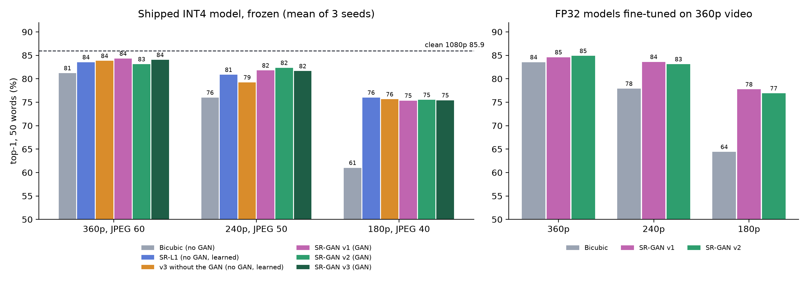
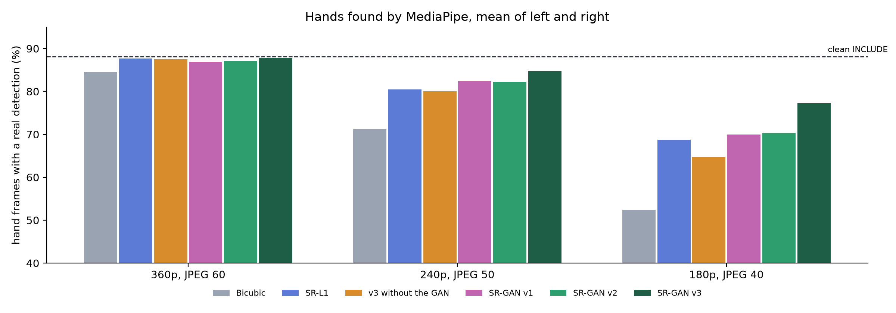
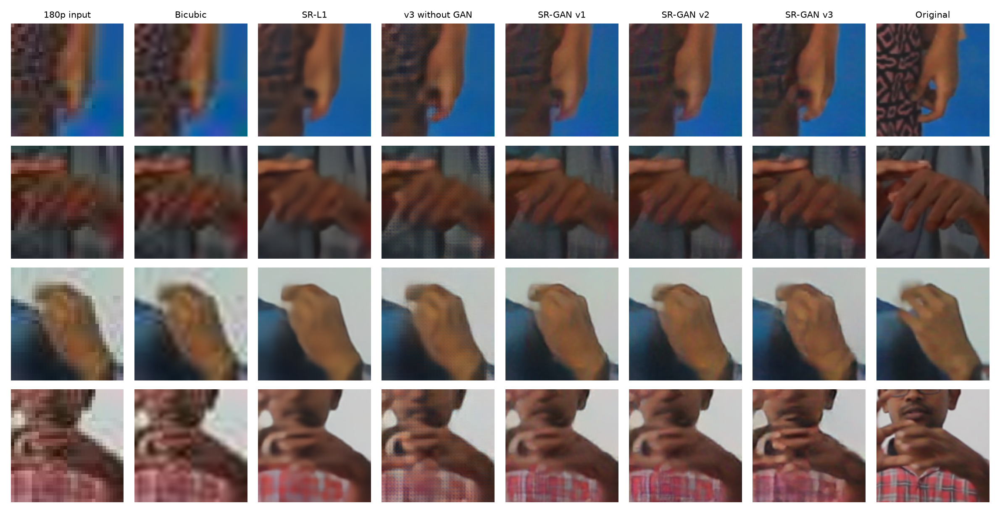

# GAN versus no GAN: three super-resolution GANs in front of an Indian Sign Language recogniser

**Team 3** · 23CSE473 Neural Networks and Deep Learning · Faculty guide: Dr. T. Bagyammal  
Department of Computer Science and Engineering, Amrita School of Computing, Amrita Vishwa Vidyapeetham, Coimbatore

| Name | Roll number |
|---|---|
| Yalamanchi Kushal | CB.SC.U4CSE23766 |
| Nethi Kushala Kumar | CB.SC.U4CSE23735 |
| Dhruseek Rishi Menon | CB.SC.U4CSE23716 |

*Generated by `python -m islvit.gan_report`. Every number is read from a result file under `runs/` when the document is built; Section 10 lists the files.*

## 1. The question

ISL-ViT-Tiny, the shipped 4-bit sign classifier, scores 85.9 % top-1 on the 472 held-out test clips of its 50 deployed words when the video is the dataset's native 1080p. A camera on glasses or a phone may deliver much smaller, compressed video. This study asks one question: **when the input is low-resolution, does putting a super-resolution GAN in front of the recogniser give better accuracy than not using one?**

"Not using a GAN" has two meanings, and the study tests both:

- **Bicubic upscaling**, the pipeline as it was: the low-resolution frame is resized with bicubic interpolation. This answers whether the GAN beats doing nothing.
- **The same generator trained without the adversarial loss** (SR-L1, and in version 3 the hand-loss arm). This answers whether any gain comes from the *adversarial* training, which is what makes it a GAN, or simply from a learned upscaler. Without this control, a GAN that beats bicubic would prove only that learning to upscale helps.

We built three GANs in sequence, and each one answers a question the previous one raised.

## 2. Where the GAN sits, and why there

Every clip reaches the hand detector through one function, `islvit/data/crops.py::read_sampled_frames`. If the video is below the 720p working height, that function resizes it to 720p before MediaPipe Holistic looks for the hands, face and body; the detector's boxes and 21-joint hand landmarks are what the classifier reads. That resize was bicubic. The GAN replaces only that resize, and only when the server or the extraction tools are given a generator file (`--sr`).

```
video -> decode -> [below 720p?  bicubic  |  generator x4, then area-resize to 720p] -> MediaPipe -> crops + landmarks -> classifier
```

This placement was chosen because it is the one point where low resolution enters the pipeline, and because everything downstream, both the hand crops and the landmarks, is computed from the upscaled frame. Two alternatives were rejected: generating synthetic training clips with a GAN (about 15 clips per word is too little to train a video generator that keeps signs correct), and upscaling the crops after detection (that cannot help the detector, which is where low-resolution video does the most damage). Video at 720p or above never passes through the generator, so the result on clean 1080p video cannot change; this was verified (Section 6).

## 3. The comparison arms

| Arm | GAN? | Generator | How it was trained | Tested on the 472 test clips |
|---|---|---|---|---|
| Bicubic | no | none | — | yes |
| SR-L1 | no | SRVGG-compact, 621,424 parameters | pixel L1 loss only, 100,000 iterations | yes |
| SR-GAN v1 | yes | same as SR-L1 | from SR-L1: L1 + VGG19 perceptual + adversarial (BCE), 60,000 iterations | yes |
| SR-GAN v2 | yes | same as SR-L1 | from v1 with a new discriminator, 80,000 more iterations | yes |
| v3 base (L1) | no | wider and deeper, 2,039,568 parameters | pixel L1, 100,000 iterations, new data and degradations | validation only |
| SR-GAN v3 | yes | v3 | from v3 base: L1 + perceptual + relativistic adversarial + hand-landmark losses, 60,000 iterations | yes |
| v3 GAN without hand losses | yes | v3 | as SR-GAN v3 without the hand-landmark losses | validation only |
| v3 without the GAN | no | v3 | from v3 base: L1 + hand-landmark losses, no discriminator, 60,000 iterations | yes |

Each GAN has a matching no-GAN control built from the same generator and data: SR-L1 for v1 and v2, and "v3 without the GAN" for v3. The two arms marked *validation only* were used to develop v3 and were not run on the test set (Section 5.6).

## 4. How each GAN was built, how they differ, and why each was needed

### 4.1 Common to all three

- **Training data.** High-resolution patches of 128 × 128 pixels taken only from INCLUDE recording sessions used for training. A check in `islvit/sr/patches.py` refuses any clip from the test sessions. About half the patches are detected hand and face crops and half are random patches from whole 720p frames.
- **Degradation.** Each patch is degraded at random, following Real-ESRGAN's second-order scheme (`islvit/sr/degrade.py`): blur (Gaussian, or motion blur in a quarter of cases), random resize, Gaussian or shot noise and JPEG compression, applied twice, then a final ×4 downscale and JPEG. The generator learns to invert this.
- **Generator.** Real-ESRGAN's compact VGG-style network: 3 × 3 convolutions with PReLU at the low resolution, a ×4 pixel shuffle, and a nearest-neighbour upsample of the input added as a residual.
- **Discriminator.** A U-Net with spectral normalisation (4,376,897 parameters) that gives a real/fake score for every pixel, so it can object to an implausible fingertip without objecting to the palm beside it.
- **Losses.** Pixel L1 (weight 1), VGG19 perceptual loss (weight 1) and the adversarial loss (weight 0.1).
- **Schedule.** A fixed number of iterations chosen before training, cosine learning-rate decay, and the exponential moving average of the weights (decay 0.999) kept at the end. No checkpoint was selected by looking at a result. The discriminator and the VGG network run in bfloat16; the generator stays in float32.

### 4.2 SR-GAN v1: the planned GAN

**Built.** Stage 1 trained the generator (621,424 parameters: 64 channels, 16 layers) with the L1 loss alone for 100,000 iterations at batch 32 and learning rate 0.0002 (55.6 min). That network is **SR-L1**, the no-GAN control. Stage 2 started from SR-L1 and added the discriminator, the perceptual loss and the adversarial loss (binary cross-entropy) for 60,000 iterations at batch 16 and learning rate 0.0001 (236.8 min).

**Why it was needed.** This is the GAN of the original, pre-registered plan, built as Real-ESRGAN describes and compared against both bicubic and SR-L1.

**A change made before it ran.** The plan was 100,000 adversarial iterations. In float32 one adversarial step ran at 1.4 iterations per second, too slow for the time available, so the discriminator and VGG were moved to bfloat16 and the batch to 16 (4.2–4.3 iterations per second) and the count fixed at 60,000 before the run started.

**What its training showed.** By the end the discriminator was clearly winning: it scored real patches 0.86 and generated ones 0.14, and the generator's adversarial loss had risen to 3.00.

### 4.3 SR-GAN v2: the same GAN, trained longer

**Built.** v2 starts from v1's generator with a **new, untrained discriminator** and trains for 80,000 more iterations at half the peak learning rate (5e-05), 261.4 min. The generator has therefore had 140,000 adversarial iterations in all. Architecture, data, degradation and losses are unchanged. Storing the tensors in channels-last order raised the average training speed from 4.2 to 5.1 iterations per second without changing the computation.

**How it differs from v1.** Only in training length and in the restarted discriminator.

**Why it was needed.** v1 was cut from 100,000 to 60,000 iterations, and its discriminator had come to dominate. If v1 merely failed to separate from SR-L1 because it was undertrained, v2 would show it. v2 was designed after v1's results were known, so it is outside the pre-registered plan; both are reported in full.

**What its training showed.** At the end the discriminator scored real and generated patches 0.79 and 0.21: still winning, less decisively.

### 4.4 SR-GAN v3: a GAN trained for what the recogniser needs

**Why it was needed.** v1 and v2 helped against bicubic but hardly against SR-L1, so the adversarial loss was not what made the difference. Two diagnostics on the 180p test video then showed where the remaining error was (Section 7.5). First, with clean pixels but degraded landmarks the classifier lost much more than with degraded pixels but clean landmarks, so most of what super-resolution still lost was in the hand landmarks. Second, tuning the hand detector did not recover it. A GAN that only produces realistic-looking texture does not address that. v3 is a GAN whose objective includes reading the hands correctly.

**Built.** Four changes, all decided before any v3 arm was trained:

1. **A hand-landmark loss.** MediaPipe is not differentiable, so a stand-in was trained (`islvit/sr/handproxy.py`): a ResNet-18 whose features are expanded by three transposed convolutions into 21 heatmaps, read out by soft-argmax. It learned from 43,682 hand crops whose MediaPipe landmarks were checked to belong to the crop, for 20 epochs. On 2,466 crops from the validation sessions its mean landmark error is 0.0215 of the crop width, with 91.4 % of points within 0.05; MediaPipe re-run on the same crops differs from its own stored labels by 0.041 on average. During GAN training the proxy is frozen, and the generator is penalised by the distance between the proxy's landmarks on its output and on the original (weight 2.0) and between their intermediate features (weight 0.2). Every batch is half hand crops for this purpose.
2. **A larger generator:** 96 channels and 24 layers, 2,039,568 parameters (3.3 times v1's), for a wider view of each hand.
3. **Camera-like compression.** Half the training samples are compressed with H.264 intra coding (CRF 23–43) instead of JPEG, as phone and glasses video is.
4. **A relativistic adversarial loss** (RaGAN) in place of plain cross-entropy, which compares real and generated scores against each other and is less prone to a runaway discriminator.

The v3 L1 base trained for 100,000 iterations (140.3 min). Three arms then trained from it for 60,000 iterations each, so that the effect of each ingredient can be read off: the full GAN with hand losses (**SR-GAN v3**, 280.2 min), the GAN without hand losses (259.3 min), and the hand losses without any discriminator (**v3 without the GAN**, 74.5 min).

**Kept out of v3's training.** The original validation sessions (888 clips, separate from the test sessions) were removed from v3's patches and from the proxy's data, so that v3 could be developed on them without touching the test set.

### 4.5 The three GANs side by side

| | SR-GAN v1 | SR-GAN v2 | SR-GAN v3 |
|---|---|---|---|
| Generator | 64 ch × 16 layers, 621,424 | same | 96 ch × 24 layers, 2,039,568 |
| Starts from | SR-L1 | v1 | v3 L1 base |
| Adversarial loss | BCE, weight 0.1 | BCE, weight 0.1 | relativistic (RaGAN), weight 0.1 |
| Other losses | L1, VGG19 | L1, VGG19 | L1, VGG19, hand landmarks (2), hand features (0.2) |
| Degradation | blur, resize, noise, JPEG | same | same + H.264 on half |
| Training data | train + validation sessions | same | train sessions only, + 43,682 hand crops |
| Adversarial iterations | 60,000 | 140,000 in total | 60,000 |
| Training time | 55.6 + 236.8 min | + 261.4 min | 140.3 + 280.2 min |
| Discriminator at the end (real / fake) | 0.86 / 0.14 | 0.79 / 0.21 | 0.75 / 0.17 |
| Pre-registered | yes | no (designed after v1) | no (designed after the diagnostics) |

## 5. Testing parameters

### 5.1 Test data

- The 472 held-out clips of the 50 deployed words (`splits/_test472_paths.csv`), from recording sessions that neither the classifier nor any generator was trained on. The same 472 clips are used for every arm.
- Degradation inside the frame reader, before detection, deterministic so every arm sees identical inputs (`islvit/sr/degrade.py::degrade_frame`): area downscale to the target height, then one JPEG encode with OpenCV.

| Level | Height | JPEG quality | Upscale factor to 720p |
|---|---|---|---|
| 360p | 360 | 60 | ×2 |
| 240p | 240 | 50 | ×3 |
| 180p | 180 | 40 | ×4 |
| Clean | 1080 (native) | — | none; the generator is never used |

- Bicubic: `cv2.resize(..., INTER_CUBIC)` to 720p. Generators: ×4, then area resize to exactly 720p.
- Per front end: 32 frames per clip, 128-pixel crops, landmarks extracted through the same front end (`islvit/data/crops.py`, `islvit/data/landmarks.py`). The classifier reads 16 of the 32 frames at 64 pixels.

### 5.2 Models scored

- **Frozen 4-bit:** the three released models `release/isl_vit_tiny_lm_int4_s{0,1,2}.pt`, unchanged.
- **Frozen 32-bit:** the three full-precision landmark models they were quantised from (`runs/f16_262w_lm_s{0,1,2}`).
- **Fine-tuned:** the 32-bit models fine-tuned for 150 epochs on the 2,845 training clips degraded to 360p (JPEG 60) and passed through bicubic, SR-GAN v1 or SR-GAN v2; learning rate 10⁻⁴, resolution jitter 0.5, 16 frames, landmarks on, final epoch kept, three seeds per arm. This asks whether the GAN still helps once the classifier has adapted to low-resolution input.

### 5.3 Metric

Top-1 and top-5 accuracy over the 50 deployed words: the model's 262 output scores are averaged over six views (three temporal sampling phases, each with and without a horizontal flip), the 212 other words are set to zero, and the highest remaining word is the answer (`islvit/mask50.py`). Each figure is the mean of three seeds; the best seed is never quoted, since choosing it would be selection on the test set.

### 5.4 Statistics and the decision rule

Arms are compared on identical clips with an exact two-sided McNemar test, pooling over the three seeds the clips that one arm gets right and the other wrong. The rule was fixed before the first test run: an arm **helps** only if its mean top-1 is higher, all three seeds move in the same direction, and p < 0.05; it **hurts** under the mirror conditions; anything else is **no reliable difference**. For scale, five seeds of one classifier configuration trained earlier in the project varied with a standard deviation of 1.9 points, so differences of a point or two are within seed noise.

### 5.5 Detection and hallucination measures

For each front end the hand and face detections are compared with the clean 1080p extraction of the same clips (`islvit/sr/study.py detection`): the share of frames with a genuine detection; **extra hands**, found in degraded video but not in clean video, which is how a GAN that invents hands would show; **missed hands**; the median wrist error; and **misplaced hands**, present in both but more than 5 % of the frame height apart. CISLR, a second corpus natively 300 × 300 pixels, was used for a detection-only check.

### 5.6 Development on the validation sessions (v3 only)

v3's arms were compared on 200 clips from the validation sessions before any test run, by running MediaPipe on the super-resolved video and comparing with the clean video's landmarks (`islvit/sr/diag_detector.py`). Re-extracting clean video gives a noise floor of about 1.5 % of hand frames. Classifier accuracy could not be used here, because the released classifiers were trained with these sessions included. On the test set only the two v3 arms that bracket the trade-off seen on validation were run: the full SR-GAN v3 and v3 without the GAN.

### 5.7 Image quality

1200 held-out 128-pixel patches, degraded to each level, scored by PSNR, SSIM (implemented in PyTorch) and sharpness (variance of the Laplacian), with the generator's time per patch on the GPU (`islvit/sr/evaluate.py`).

## 6. How the measurements were verified

- **No leakage.** The patch builder and the proxy's data builder assert that no test-session clip is used; v3 additionally excludes the validation sessions. Fine-tuning clips come from the training split only.
- **Clean video untouched.** Crops and detection records for clean 1080p clips extracted with and without `--sr` were byte-identical.
- **No mixing of front ends.** Every cache records its degradation, generator file and generator checksum (`FRONTEND.json`); landmarks are refused if they come from a different front end than the crops beside them.
- **Deterministic detection.** MediaPipe kept state between videos, which changed hand presence on 3–6 % of frames when a clip was processed twice; the detectors are rebuilt for every video, after which repeated runs agree exactly.
- **No selection on results.** Iteration counts, loss weights, epochs and the decision rule were fixed before each run; final weights are always used.
- **Precision of v3 test extraction.** v3's test caches were built with the generator in 16-bit floating point to save time. On real degraded frames this changed no pixel by more than 1/255 (mean 0.03/255), and the precision is recorded in each cache's `FRONTEND.json`.
- **Diagnostics separate pixels from landmarks.** Re-scoring with clean crops and degraded landmarks, and with degraded crops and clean landmarks, located the remaining loss (Section 7.5).
- **Detector control.** Landmarks re-extracted from the same super-resolved frames with lower thresholds, a larger and multi-scale search region and gap filling tested whether the detector, rather than the image, was the limit.

## 7. Results

### 7.1 Accuracy, frozen 4-bit models

Top-1 (%), mean ± sd over three seeds. Clean 1080p video does not pass through any generator, so all arms share the clean figure.

| Input | Bicubic (no GAN) | SR-L1 (no GAN, learned) | v3 without the GAN (no GAN, learned) | SR-GAN v1 (GAN) | SR-GAN v2 (GAN) | SR-GAN v3 (GAN) |
|---|---|---|---|---|---|---|
| Clean 1080p | 85.9 ± 1.5 | 85.9 ± 1.5 | 85.9 ± 1.5 | 85.9 ± 1.5 | 85.9 ± 1.5 | 85.9 ± 1.5 |
| 360p, JPEG 60 | 81.2 ± 1.5 | 83.5 ± 1.4 | 83.8 ± 1.3 | 84.3 ± 1.4 | 83.1 ± 1.3 | 84.0 ± 1.4 |
| 240p, JPEG 50 | 76.0 ± 1.1 | 80.9 ± 1.2 | 79.2 ± 2.0 | 81.8 ± 1.7 | 82.3 ± 2.1 | 81.6 ± 1.4 |
| 180p, JPEG 40 | 61.0 ± 1.4 | 76.0 ± 1.0 | 75.6 ± 1.1 | 75.4 ± 2.2 | 75.5 ± 3.6 | 75.4 ± 1.1 |

Top-5 (%) on the same runs:

| Input | Bicubic | SR-L1 | v3 without the GAN | SR-GAN v1 | SR-GAN v2 | SR-GAN v3 |
|---|---|---|---|---|---|---|
| 360p, JPEG 60 | 95.3 | 96.0 | 95.8 | 95.6 | 96.0 | 95.9 |
| 240p, JPEG 50 | 92.0 | 95.1 | 95.3 | 95.0 | 94.8 | 94.9 |
| 180p, JPEG 40 | 82.5 | 92.1 | 92.0 | 91.9 | 92.7 | 92.4 |



### 7.2 GAN versus no GAN, paired tests

Δ is the change in mean top-1 (percentage points) from the second arm to the first; per-seed changes in brackets; clips gained / lost pooled over seeds.

**Frozen 4-bit models**

| Input | Comparison | Δ top-1 (per seed) | clips gained / lost | p | verdict |
|---|---|---|---|---|---|
| 360p, JPEG 60 | SR-GAN v1 vs bicubic | +3.1 (+2.1 / +3.0 / +4.2) | 75 / 31 | 2.3 × 10⁻⁵ | **helps** |
| 360p, JPEG 60 | SR-GAN v1 vs SR-L1 | +0.8 (+1.1 / +1.1 / +0.2) | 35 / 24 | 0.19 | **no reliable difference** |
| 360p, JPEG 60 | SR-GAN v2 vs bicubic | +1.9 (+1.1 / +1.7 / +3.0) | 73 / 46 | 0.017 | **helps** |
| 360p, JPEG 60 | SR-GAN v2 vs SR-L1 | -0.4 (+0.0 / -0.2 / -1.1) | 28 / 34 | 0.53 | **no reliable difference** |
| 360p, JPEG 60 | SR-GAN v2 vs v1 | -1.2 (-1.1 / -1.3 / -1.3) | 16 / 33 | 0.021 | **hurts** |
| 360p, JPEG 60 | SR-GAN v3 vs bicubic | +2.8 (+1.5 / +1.7 / +5.3) | 71 / 31 | 9.3 × 10⁻⁵ | **helps** |
| 360p, JPEG 60 | SR-GAN v3 vs SR-L1 | +0.5 (+0.4 / -0.2 / +1.3) | 30 / 23 | 0.41 | **no reliable difference** |
| 360p, JPEG 60 | SR-GAN v3 vs v3 without the GAN | +0.2 (-0.6 / -0.8 / +2.1) | 33 / 30 | 0.8 | **no reliable difference** |
| 360p, JPEG 60 | SR-GAN v3 vs v2 | +0.9 (+0.4 / +0.0 / +2.3) | 40 / 27 | 0.14 | **no reliable difference** |
| 360p, JPEG 60 | SR-L1 vs bicubic (no GAN) | +2.3 (+1.1 / +1.9 / +4.0) | 66 / 33 | 0.0012 | **helps** |
| 360p, JPEG 60 | v3 without the GAN vs bicubic | +2.6 (+2.1 / +2.5 / +3.2) | 64 / 27 | 1.3 × 10⁻⁴ | **helps** |
| 240p, JPEG 50 | SR-GAN v1 vs bicubic | +5.8 (+5.5 / +6.6 / +5.3) | 138 / 56 | 3.6 × 10⁻⁹ | **helps** |
| 240p, JPEG 50 | SR-GAN v1 vs SR-L1 | +0.9 (+0.6 / +1.5 / +0.6) | 43 / 30 | 0.16 | **no reliable difference** |
| 240p, JPEG 50 | SR-GAN v2 vs bicubic | +6.4 (+6.4 / +7.6 / +5.1) | 142 / 52 | 7.6 × 10⁻¹¹ | **helps** |
| 240p, JPEG 50 | SR-GAN v2 vs SR-L1 | +1.5 (+1.5 / +2.5 / +0.4) | 49 / 28 | 0.022 | **helps** |
| 240p, JPEG 50 | SR-GAN v2 vs v1 | +0.6 (+0.8 / +1.1 / -0.2) | 31 / 23 | 0.34 | **no reliable difference** |
| 240p, JPEG 50 | SR-GAN v3 vs bicubic | +5.6 (+5.1 / +5.7 / +6.1) | 140 / 60 | 1.5 × 10⁻⁸ | **helps** |
| 240p, JPEG 50 | SR-GAN v3 vs SR-L1 | +0.8 (+0.2 / +0.6 / +1.5) | 52 / 41 | 0.3 | **no reliable difference** |
| 240p, JPEG 50 | SR-GAN v3 vs v3 without the GAN | +2.4 (+2.3 / +1.3 / +3.6) | 68 / 34 | 9.9 × 10⁻⁴ | **helps** |
| 240p, JPEG 50 | SR-GAN v3 vs v2 | -0.7 (-1.3 / -1.9 / +1.1) | 38 / 48 | 0.33 | **no reliable difference** |
| 240p, JPEG 50 | SR-L1 vs bicubic (no GAN) | +4.9 (+4.9 / +5.1 / +4.7) | 125 / 56 | 3.1 × 10⁻⁷ | **helps** |
| 240p, JPEG 50 | v3 without the GAN vs bicubic | +3.2 (+2.8 / +4.4 / +2.5) | 102 / 56 | 3.1 × 10⁻⁴ | **helps** |
| 180p, JPEG 40 | SR-GAN v1 vs bicubic | +14.3 (+14.0 / +15.5 / +13.6) | 261 / 58 | 6.8 × 10⁻³² | **helps** |
| 180p, JPEG 40 | SR-GAN v1 vs SR-L1 | -0.6 (-2.1 / +0.6 / -0.4) | 56 / 65 | 0.47 | **no reliable difference** |
| 180p, JPEG 40 | SR-GAN v2 vs bicubic | +14.5 (+13.3 / +17.4 / +12.7) | 265 / 60 | 7.0 × 10⁻³² | **helps** |
| 180p, JPEG 40 | SR-GAN v2 vs SR-L1 | -0.5 (-2.8 / +2.5 / -1.3) | 56 / 63 | 0.58 | **no reliable difference** |
| 180p, JPEG 40 | SR-GAN v2 vs v1 | +0.1 (-0.6 / +1.9 / -0.8) | 39 / 37 | 0.91 | **no reliable difference** |
| 180p, JPEG 40 | SR-GAN v3 vs bicubic | +14.4 (+15.3 / +14.4 / +13.6) | 265 / 61 | 1.9 × 10⁻³¹ | **helps** |
| 180p, JPEG 40 | SR-GAN v3 vs SR-L1 | -0.6 (-0.8 / -0.4 / -0.4) | 53 / 61 | 0.51 | **no reliable difference** |
| 180p, JPEG 40 | SR-GAN v3 vs v3 without the GAN | -0.2 (+0.2 / +0.0 / -0.8) | 59 / 62 | 0.86 | **no reliable difference** |
| 180p, JPEG 40 | SR-GAN v3 vs v2 | -0.1 (+1.9 / -3.0 / +0.8) | 62 / 63 | 1 | **no reliable difference** |
| 180p, JPEG 40 | SR-L1 vs bicubic (no GAN) | +15.0 (+16.1 / +14.8 / +14.0) | 269 / 57 | 4.5 × 10⁻³⁴ | **helps** |
| 180p, JPEG 40 | v3 without the GAN vs bicubic | +14.6 (+15.0 / +14.4 / +14.4) | 252 / 45 | 4.5 × 10⁻³⁶ | **helps** |

**Frozen 32-bit models**

| Input | Comparison | Δ top-1 (per seed) | clips gained / lost | p | verdict |
|---|---|---|---|---|---|
| 360p, JPEG 60 | SR-GAN v1 vs bicubic | -0.1 (-0.2 / +0.2 / -0.4) | 55 / 57 | 0.92 | **no reliable difference** |
| 360p, JPEG 60 | SR-GAN v1 vs SR-L1 | -0.1 (+1.1 / +0.2 / -1.7) | 28 / 30 | 0.9 | **no reliable difference** |
| 360p, JPEG 60 | SR-GAN v2 vs bicubic | -0.3 (-0.6 / -0.4 / +0.2) | 54 / 58 | 0.78 | **no reliable difference** |
| 360p, JPEG 60 | SR-GAN v2 vs SR-L1 | -0.3 (+0.6 / -0.4 / -1.1) | 32 / 36 | 0.72 | **no reliable difference** |
| 360p, JPEG 60 | SR-GAN v2 vs v1 | -0.1 (-0.4 / -0.6 / +0.6) | 28 / 30 | 0.9 | **no reliable difference** |
| 360p, JPEG 60 | SR-GAN v3 vs bicubic | +0.0 (-0.2 / -0.8 / +1.1) | 51 / 51 | 1 | **no reliable difference** |
| 360p, JPEG 60 | SR-GAN v3 vs SR-L1 | +0.0 (+1.1 / -0.8 / -0.2) | 33 / 33 | 1 | **no reliable difference** |
| 360p, JPEG 60 | SR-GAN v3 vs v3 without the GAN | -0.2 (-0.4 / -0.8 / +0.6) | 33 / 36 | 0.81 | **no reliable difference** |
| 360p, JPEG 60 | SR-GAN v3 vs v2 | +0.3 (+0.4 / -0.4 / +0.8) | 44 / 40 | 0.74 | **no reliable difference** |
| 360p, JPEG 60 | SR-L1 vs bicubic (no GAN) | +0.0 (-1.3 / +0.0 / +1.3) | 51 / 51 | 1 | **no reliable difference** |
| 360p, JPEG 60 | v3 without the GAN vs bicubic | +0.2 (+0.2 / +0.0 / +0.4) | 38 / 35 | 0.82 | **no reliable difference** |
| 240p, JPEG 50 | SR-GAN v1 vs bicubic | +7.7 (+10.0 / +8.1 / +5.1) | 162 / 53 | 4.9 × 10⁻¹⁴ | **helps** |
| 240p, JPEG 50 | SR-GAN v1 vs SR-L1 | +1.6 (+1.5 / +2.1 / +1.1) | 51 / 29 | 0.018 | **helps** |
| 240p, JPEG 50 | SR-GAN v2 vs bicubic | +7.0 (+9.5 / +7.2 / +4.2) | 155 / 56 | 6.2 × 10⁻¹² | **helps** |
| 240p, JPEG 50 | SR-GAN v2 vs SR-L1 | +0.8 (+1.1 / +1.3 / +0.2) | 49 / 37 | 0.24 | **no reliable difference** |
| 240p, JPEG 50 | SR-GAN v2 vs v1 | -0.7 (-0.4 / -0.8 / -0.8) | 25 / 35 | 0.25 | **no reliable difference** |
| 240p, JPEG 50 | SR-GAN v3 vs bicubic | +5.3 (+6.4 / +6.1 / +3.4) | 144 / 69 | 3.0 × 10⁻⁷ | **helps** |
| 240p, JPEG 50 | SR-GAN v3 vs SR-L1 | -0.8 (-2.1 / +0.2 / -0.6) | 39 / 51 | 0.25 | **no reliable difference** |
| 240p, JPEG 50 | SR-GAN v3 vs v3 without the GAN | -0.8 (+0.4 / -1.9 / -1.1) | 48 / 60 | 0.29 | **no reliable difference** |
| 240p, JPEG 50 | SR-GAN v3 vs v2 | -1.7 (-3.2 / -1.1 / -0.8) | 38 / 62 | 0.021 | **hurts** |
| 240p, JPEG 50 | SR-L1 vs bicubic (no GAN) | +6.1 (+8.5 / +5.9 / +4.0) | 144 / 57 | 7.2 × 10⁻¹⁰ | **helps** |
| 240p, JPEG 50 | v3 without the GAN vs bicubic | +6.1 (+5.9 / +8.1 / +4.4) | 144 / 57 | 7.2 × 10⁻¹⁰ | **helps** |
| 180p, JPEG 40 | SR-GAN v1 vs bicubic | +18.2 (+20.3 / +19.7 / +14.6) | 315 / 57 | 2.2 × 10⁻⁴⁴ | **helps** |
| 180p, JPEG 40 | SR-GAN v1 vs SR-L1 | +0.8 (+0.4 / +1.5 / +0.6) | 70 / 58 | 0.33 | **no reliable difference** |
| 180p, JPEG 40 | SR-GAN v2 vs bicubic | +17.4 (+19.1 / +18.6 / +14.6) | 311 / 64 | 4.7 × 10⁻⁴⁰ | **helps** |
| 180p, JPEG 40 | SR-GAN v2 vs SR-L1 | +0.1 (-0.8 / +0.4 / +0.6) | 59 / 58 | 1 | **no reliable difference** |
| 180p, JPEG 40 | SR-GAN v2 vs v1 | -0.8 (-1.3 / -1.1 / +0.0) | 41 / 52 | 0.3 | **no reliable difference** |
| 180p, JPEG 40 | SR-GAN v3 vs bicubic | +16.3 (+20.8 / +15.0 / +13.1) | 306 / 75 | 3.3 × 10⁻³⁴ | **helps** |
| 180p, JPEG 40 | SR-GAN v3 vs SR-L1 | -1.1 (+0.8 / -3.2 / -0.8) | 72 / 87 | 0.27 | **no reliable difference** |
| 180p, JPEG 40 | SR-GAN v3 vs v3 without the GAN | -1.7 (-0.6 / -3.2 / -1.3) | 67 / 91 | 0.067 | **no reliable difference** |
| 180p, JPEG 40 | SR-GAN v3 vs v2 | -1.1 (+1.7 / -3.6 / -1.5) | 64 / 80 | 0.21 | **no reliable difference** |
| 180p, JPEG 40 | SR-L1 vs bicubic (no GAN) | +17.4 (+19.9 / +18.2 / +14.0) | 306 / 60 | 7.6 × 10⁻⁴¹ | **helps** |
| 180p, JPEG 40 | v3 without the GAN vs bicubic | +18.0 (+21.4 / +18.2 / +14.4) | 300 / 45 | 2.2 × 10⁻⁴⁷ | **helps** |

### 7.3 After fine-tuning the classifier on 360p video

| Input | Bicubic | SR-GAN v1 | SR-GAN v2 |
|---|---|---|---|
| Clean 1080p | 85.8 ± 2.1 | 86.4 ± 1.5 | 85.9 ± 1.6 |
| 360p, JPEG 60 | 83.5 ± 1.9 | 84.6 ± 1.6 | 84.9 ± 2.1 |
| 240p, JPEG 50 | 77.9 ± 2.0 | 83.6 ± 1.2 | 83.1 ± 1.4 |
| 180p, JPEG 40 | 64.4 ± 2.2 | 77.8 ± 1.7 | 76.9 ± 2.2 |

| Input | Comparison | Δ top-1 (per seed) | clips gained / lost | p | verdict |
|---|---|---|---|---|---|
| 360p, JPEG 60 | SR-GAN v1 vs bicubic | +1.1 (+0.6 / +1.1 / +1.5) | 58 / 43 | 0.16 | **no reliable difference** |
| 360p, JPEG 60 | SR-GAN v2 vs bicubic | +1.3 (+1.1 / +1.7 / +1.3) | 58 / 39 | 0.067 | **no reliable difference** |
| 360p, JPEG 60 | SR-GAN v2 vs v1 | +0.3 (+0.4 / +0.6 / -0.2) | 29 / 25 | 0.68 | **no reliable difference** |
| 240p, JPEG 50 | SR-GAN v1 vs bicubic | +5.7 (+7.0 / +5.5 / +4.7) | 116 / 35 | 2.4 × 10⁻¹¹ | **helps** |
| 240p, JPEG 50 | SR-GAN v2 vs bicubic | +5.2 (+7.4 / +5.1 / +3.2) | 122 / 48 | 1.3 × 10⁻⁸ | **helps** |
| 240p, JPEG 50 | SR-GAN v2 vs v1 | -0.5 (+0.4 / -0.4 / -1.5) | 33 / 40 | 0.48 | **no reliable difference** |
| 180p, JPEG 40 | SR-GAN v1 vs bicubic | +13.3 (+15.3 / +13.8 / +11.0) | 244 / 55 | 1.4 × 10⁻²⁹ | **helps** |
| 180p, JPEG 40 | SR-GAN v2 vs bicubic | +12.5 (+14.2 / +13.6 / +9.7) | 242 / 65 | 3.9 × 10⁻²⁵ | **helps** |
| 180p, JPEG 40 | SR-GAN v2 vs v1 | -0.8 (-1.1 / -0.2 / -1.3) | 45 / 57 | 0.28 | **no reliable difference** |

The v3 front ends were not fine-tuned against; see Section 8.2.

### 7.4 Detection and hallucination

| Input | Arm | Left hand | Right hand | Face | Extra hands | Missed hands | Wrist error (median) | Misplaced |
|---|---|---|---|---|---|---|---|---|
| 360p, JPEG 60 | Bicubic | 86.7 | 82.5 | 99.9 | 2.3 | 7.4 | 0.43 | 1.9 |
| 360p, JPEG 60 | SR-L1 | 88.5 | 86.9 | 100.0 | 2.8 | 4.8 | 0.31 | 1.5 |
| 360p, JPEG 60 | v3 without the GAN | 89.3 | 85.6 | 100.0 | 2.1 | 4.4 | 0.30 | 1.4 |
| 360p, JPEG 60 | SR-GAN v1 | 88.7 | 85.0 | 100.0 | 2.2 | 5.1 | 0.31 | 1.4 |
| 360p, JPEG 60 | SR-GAN v2 | 89.1 | 85.0 | 100.0 | 2.3 | 5.0 | 0.33 | 1.4 |
| 360p, JPEG 60 | SR-GAN v3 | 89.2 | 86.4 | 100.0 | 2.6 | 4.5 | 0.31 | 1.6 |
| 240p, JPEG 50 | Bicubic | 71.1 | 71.2 | 86.9 | 2.3 | 20.8 | 0.73 | 5.1 |
| 240p, JPEG 50 | SR-L1 | 80.1 | 80.8 | 99.8 | 2.5 | 11.8 | 0.50 | 3.0 |
| 240p, JPEG 50 | v3 without the GAN | 81.3 | 78.8 | 99.6 | 1.9 | 11.5 | 0.44 | 2.2 |
| 240p, JPEG 50 | SR-GAN v1 | 82.7 | 82.0 | 99.9 | 2.6 | 10.0 | 0.50 | 2.8 |
| 240p, JPEG 50 | SR-GAN v2 | 83.2 | 81.3 | 99.9 | 2.7 | 10.2 | 0.51 | 2.8 |
| 240p, JPEG 50 | SR-GAN v3 | 85.3 | 84.1 | 99.9 | 3.3 | 8.3 | 0.47 | 2.6 |
| 180p, JPEG 40 | Bicubic | 51.0 | 53.8 | 33.5 | 1.9 | 39.3 | 1.15 | 8.4 |
| 180p, JPEG 40 | SR-L1 | 68.2 | 69.4 | 98.6 | 2.6 | 23.5 | 0.78 | 5.1 |
| 180p, JPEG 40 | v3 without the GAN | 65.5 | 63.7 | 96.3 | 1.0 | 26.1 | 0.62 | 3.5 |
| 180p, JPEG 40 | SR-GAN v1 | 67.9 | 72.0 | 99.8 | 2.6 | 22.4 | 0.76 | 4.4 |
| 180p, JPEG 40 | SR-GAN v2 | 68.6 | 71.9 | 99.9 | 2.6 | 22.1 | 0.77 | 4.7 |
| 180p, JPEG 40 | SR-GAN v3 | 77.6 | 76.9 | 99.2 | 3.1 | 15.5 | 0.69 | 4.6 |

All values are percentages of hand frames, except wrist error (percent of frame height). On clean INCLUDE video the detector finds the left hand in 91.1 % and the right in 85.2 % of frames.



**CISLR (natively 300 px), left / right hand found:** Bicubic 25.0 / 48.8; SR-L1 25.9 / 49.7; SR-GAN v1 24.8 / 48.1; SR-GAN v2 24.3 / 47.7.

### 7.5 Where the remaining loss comes from (180p, frozen 4-bit)

| Front end | Both degraded | Landmarks degraded, pixels clean | Pixels degraded, landmarks clean | Clean |
|---|---|---|---|---|
| Bicubic | 61.0 | 73.7 | 79.0 | 85.9 |
| SR-GAN v2 | 75.5 | 78.2 | 83.1 | 85.9 |

Detector settings re-run on the same SR-GAN v2 frames, with clean crops (so only the landmarks change):

| Detector variant | Top-1 | Hand frames found | Extra | Misplaced |
|---|---|---|---|---|
| As used in the study | 78.2 | 70.3 | 2.6 | 4.7 |
| Lower confidence thresholds | 79.0 | 82.1 | 5.1 | 7.1 |
| Larger search region (512 px) | 78.4 | 68.0 | 2.5 | 4.4 |
| Multi-scale search region | 78.2 | 84.5 | 5.3 | 10.7 |
| All three | 78.7 | 92.3 | 7.7 | 12.0 |
| Study settings + gap filling | 78.2 | 87.8 | 8.2 | 8.4 |
| All three + gap filling | 78.1 | 99.2 | 10.2 | 14.1 |

### 7.6 v3 on the validation sessions

200 validation-session clips; MediaPipe on super-resolved video against the clean video. Handshape error is the median distance of the 21 joints from the clean ones, relative to the wrist, in hundredths of the frame height.

| Arm | Hands found, 180p | Handshape error, 180p | Hands found, 240p | Handshape error, 240p |
|---|---|---|---|---|
| Bicubic | 43.3 | 2.32 | 64.3 | 1.26 |
| SR-L1 | 64.6 | 1.30 | 78.8 | 0.83 |
| SR-GAN v2 | 63.3 | 1.30 | 78.3 | 0.84 |
| v3 base (L1) | 69.2 | 1.19 | 80.8 | 0.74 |
| v3 GAN, no hand losses | 71.7 | 1.28 | 83.2 | 0.80 |
| SR-GAN v3 | 73.3 | 1.23 | 84.0 | 0.76 |
| v3 without the GAN | 60.7 | 0.99 | 79.8 | 0.66 |

Clean video: 88.3 % of hand frames found.

### 7.7 Image quality and cost

| Input | Arm | PSNR (dB) | SSIM | Sharpness | ms per patch (GPU) |
|---|---|---|---|---|---|
| 360p | Bicubic | 34.51 | 0.940 | 24 | — |
| 360p | SR-L1 | 35.16 | 0.953 | 60 | 1.657 |
| 360p | v3 without the GAN | 33.33 | 0.943 | 75 | 3.743 |
| 360p | SR-GAN v1 | 34.49 | 0.942 | 70 | 1.487 |
| 360p | SR-GAN v2 | 34.40 | 0.942 | 71 | 1.488 |
| 360p | SR-GAN v3 | 32.82 | 0.934 | 71 | 3.474 |
| 240p | Bicubic | 31.97 | 0.893 | 8 | — |
| 240p | SR-L1 | 33.66 | 0.925 | 23 | 1.117 |
| 240p | v3 without the GAN | 31.82 | 0.907 | 45 | 2.076 |
| 240p | SR-GAN v1 | 32.69 | 0.911 | 34 | 0.877 |
| 240p | SR-GAN v2 | 32.79 | 0.912 | 34 | 0.897 |
| 240p | SR-GAN v3 | 31.38 | 0.902 | 32 | 1.855 |
| 180p | Bicubic | 30.07 | 0.856 | 4 | — |
| 180p | SR-L1 | 31.83 | 0.900 | 16 | 1.021 |
| 180p | v3 without the GAN | 29.96 | 0.863 | 61 | 1.471 |
| 180p | SR-GAN v1 | 31.07 | 0.883 | 31 | 0.806 |
| 180p | SR-GAN v2 | 31.09 | 0.884 | 32 | 0.828 |
| 180p | SR-GAN v3 | 29.76 | 0.870 | 28 | 1.267 |

Original patches have a median sharpness of 73. PSNR and SSIM reward the average of plausible answers, so a non-adversarial upscaler is expected to score higher on them and a GAN to look sharper; this is the usual trade-off between distortion and perceived quality.

Parameters: v1/v2 generator 621,424; v3 generator 2,039,568; discriminator 4,376,897 (training only).



*Hand crops from held-out INCLUDE clips (Sridhar et al., ACM MM 2020, CC-BY-4.0).*

The montage shows one effect the numbers alone hide. v3 without the GAN, trained on the hand-landmark loss with no discriminator, covers its output in a fine regular dot grid. That pattern is why its sharpness score is the highest of all the upscalers, above even the originals at 360p. The landmark loss rewards whatever makes the proxy's joints land correctly, and nothing in it objects to an unnatural texture. The same network trained with the discriminator (SR-GAN v3) shows no grid. Here the adversarial loss did the job it exists for: keeping the output looking like a real image.

## 8. What the results mean, and their limits

### 8.1 Reasoning

Learning to upscale is what recovers the accuracy. At 180p SR-GAN v2 gains 14.5 points over bicubic on the frozen 4-bit models (p = 7.0 × 10⁻³²), and every learned front end, GAN or not, lands within about a point of the others. Section 7.4 shows the mechanism: after bicubic upscaling at 180p, MediaPipe finds about half the hands and a third of the faces, and any learned upscaler restores most of them. At 360p the picture depends on the model. The 4-bit models gain 2–3 points and the 32-bit models nothing, probably because at ×2 the detector still finds most hands after bicubic (Section 7.4) and little is left to recover. We did not investigate why the 4-bit models respond to that small difference and the 32-bit models do not.

The adversarial loss adds little on top. Against their own no-GAN controls the GANs passed the rule in 2 of 9 comparisons on the frozen 4-bit models, both at 240p: SR-GAN v2 beat SR-L1 by +1.5 points, and SR-GAN v3 beat v3 without the GAN by +2.4. The second win says less than it seems, since v3 without the GAN was the weakest learned front end at 240p and SR-GAN v3 did not beat SR-L1 there. The 32-bit models show one GAN win, again at 240p (v1 over SR-L1, +1.6). At 360p and 180p no GAN beat its control on either model. The sharper texture the GANs produce (Section 7.7) mostly does not turn into accuracy. In v3 the discriminator did matter, though not for accuracy: without it the hand-landmark loss produced a visible dot-grid artifact (Section 7.7), and that arm found the fewest hands of any learned upscaler at 180p.

Training longer did not help. SR-GAN v2 was no better than v1 at any level, and worse at 360p on the 4-bit models, although its discriminator ended the run less dominant. Undertraining therefore does not explain why v1 failed to separate from SR-L1.

v3 changed what it was designed to change, but the change did not reach the accuracy. On the validation sessions SR-GAN v3 found the most hands and v3 without the GAN had the lowest handshape error, and the test set agrees: at 180p SR-GAN v3 found 77.2 % of hands against 70.3 % for v2, while v3 without the GAN had the smallest wrist error and the fewest misplaced hands. Neither was reliably more accurate than SR-GAN v2 or SR-L1. A possible reason, which we did not test, is that the frozen classifier learned from MediaPipe's landmarks on clean video and reacts to the detector's remaining errors in ways the proxy distance does not capture.

What limits accuracy after super-resolution is the detector's output, not how the image looks. Most of the remaining loss is on the landmark side (Section 7.5), and a more permissive detector found more hands but placed more of them wrongly, leaving accuracy where it was.

### 8.2 Limitations

- **Synthetic degradation.** Test video was degraded by area downscaling and one JPEG encode. Real phone or glasses video has motion blur, sensor noise and inter-frame compression; the GANs, v3 especially, were trained for some of that, and could rank differently on real low-resolution recordings.
- **One studio.** INCLUDE was recorded in one room with a fixed camera. On CISLR, the only other corpus available, pixel-only classifiers scored at chance for reasons unrelated to resolution (MediaPipe's pose model finds the wrists in a minority of its frames), so the GANs were tested there for hand detection only, not for accuracy.
- **v2 and v3 were not pre-registered.** Both were designed after earlier results were seen; their tests used the same rule, but the decision to build them was informed by the test set. v3's arms were developed on validation sessions to limit this.
- **v3 was not fine-tuned against.** The fine-tuned arm covers bicubic, v1 and v2. Whether a classifier fine-tuned on v3's output gains from its better hand detection is the most direct open question.
- **Two v3 arms were validation-only.** The v3 L1 base and the v3 GAN without hand losses were not run on the test set.
- **Different patch sets.** v3's training patches exclude the validation sessions, v1/v2's include them, so v3 trained on less INCLUDE data.
- **Image-quality patches mix crops and frame patches.** PSNR, SSIM and sharpness average over both. v3 was trained half on hand crops and partly on H.264, which may explain part of its lower PSNR than SR-L1 on this JPEG-degraded set.
- **Three seeds.** With three seeds and a seed-to-seed spread of about two points, effects of a point or two cannot be settled either way.
- **Cost.** v1 and v2 use the same network as SR-L1 and cost the same at inference. v3's generator has 3.3 times the parameters and was 1.5–2.3 times slower per patch on the GPU (Section 7.7). No latency was measured on wearable hardware.

## 9. Conclusion

On low-resolution video, a learned upscaler in front of the hand detector beats bicubic by a wide margin: 14.5 points at 180p for SR-GAN v2, with a gain of similar size after the classifier is fine-tuned. Training that upscaler as a GAN makes little further difference to recognition. We tried a plain Real-ESRGAN-style GAN, the same GAN trained longer, and a third with a larger generator, camera-like compression, a relativistic loss and a hand-landmark objective. Across the three, adversarial training sharpened the images, suppressed an artifact that the hand-landmark loss introduced, and helped v3 find more hands, yet it beat a no-GAN control in only 2 of 9 accuracy comparisons on the shipped model.

These results do not show that a GAN cannot help this recogniser; they show that the GANs we built did not, on synthetically degraded studio video and a frozen or partly adapted classifier. The remaining error sits in where the detector places the hand joints. The most direct next test is to fine-tune the classifier on SR-GAN v3's output, so that it can use the better hand detection, and to repeat the comparison on real low-resolution recordings.

## 10. Result files

| What | Where |
|---|---|
| Accuracy, frozen 4-bit, per front end and seed | `runs/gan_study/frozen_int4/` (bicubic, SR-L1, v2, v3); `runs/gan_study_v1/frozen_int4/` (v1) |
| Accuracy, frozen 32-bit | `runs/gan_study/frozen_fp32/`; `runs/gan_study_v1/frozen_fp32/` |
| Accuracy, fine-tuned | `runs/gan_study/retrained/` (bicubic, v2); `runs/gan_study_v1/retrained/` (v1) |
| Detection and hallucination | `runs/gan_study/detection/`; `runs/gan_study_v1/detection/` |
| Image quality | `runs/gan_study/sr_quality.json` (bicubic, SR-L1, v2); `runs/gan_study_v1/sr_quality.json` (v1); `runs/gan_study/sr_quality_v3_task.json`, `sr_quality_v3_base.json` (v3) |
| Diagnostics (pixels vs landmarks, detector variants, v3 validation, paired v3 tests) | `runs/gan_study/diagnostics/` |
| Generator training records | `runs/sr_l1/`, `runs/sr_gan_v1/`, `runs/sr_gan/` (v2), `runs/sr3_l1/`, `runs/sr3_gan/`, `runs/sr3_gan_task/`, `runs/sr3_l1_task/` (`summary.json`, `history.csv`) |
| Hand-landmark proxy | `runs/hand_proxy/` |
| Fine-tuned classifiers | `runs/ft360_bicubic_s*/`, `runs/ft360_srgan_v1_s*/`, `runs/ft360_srgan_s*/` (v2) |
| Figures | `docs/figures/fig21_gan_accuracy.png`, `fig22_gan_detection.png`, `fig23_gan_montage.png` |

Model weights (`*.pt`) are kept locally and not committed. To rebuild: `bash run_gan_study.sh` (bicubic, SR-L1, v1), `GAN_ITERS=80000 bash run_gan_study_v2.sh` (v2), `bash run_gan_v3.sh` and `bash run_gan_v3_test.sh` (v3), then `python -m islvit.gan_report`.
